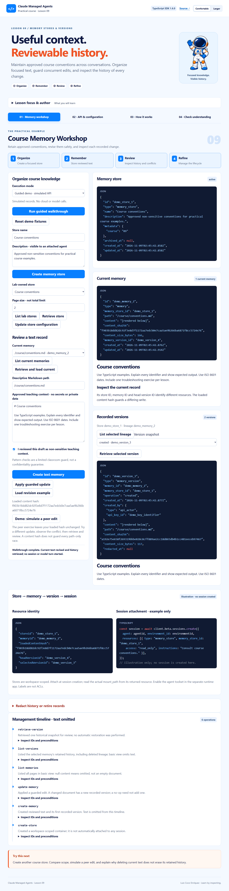

# Lesson 09 · Course Memory Workshop

A practical application for **Memory Stores, Memory and Versions**, using Claude Managed Agents through the official Anthropic TypeScript SDK. Students maintain approved course conventions, protect differing content writes with a loaded hash, and inspect historical snapshots. The layout and four teaching views follow Lessons 1–8.



## Run locally

Requires Node.js 24 and npm.

```powershell
cd "C:\Claude Managed Agents Latest version Infographic summary\practical-apps\claude-managed-agents-lesson-09"
npm ci
npm run dev
```

Open **http://127.0.0.1:4329**. Demo needs no API key. Click **Run guided walkthrough** to create a simulated store and memory, apply a guarded revision, and retrieve an earlier snapshot. No redaction or retirement happens automatically.

For a fresh checkout:

```powershell
git clone https://github.com/luiscoco/claude-managed-agents-lesson-09.git
cd claude-managed-agents-lesson-09
npm ci
npm run dev
```

## Student activities

- **Memory workshop:** store configuration, reviewed text editor, content-hash precondition, demo peer-edit conflict, current versus historical content, and management timeline.
- **API & configuration:** all 14 operations and five configuration cards, each with colored TypeScript.
- **How it works:** UML component architecture and eight selectable workflow steps, setup and a runnable example.
- **Check understanding:** six questions with immediate explanations and a practical challenge.

The shared course design includes the astronaut, pale blue canvas, navy headings, white cards, blue actions, orange callouts, keyboard tabs and larger text controls. Explanations and document text render as sanitized rich text; code fences, API examples and JSON use syntax highlighting.

## Try the conflict exercise

After the walkthrough, click **Demo: simulate a peer edit**. This changes stored content without refreshing your loaded hash. Change your draft and click **Apply guarded update** to observe a conflict. Your draft remains available. Retrieve current text, review it, make the intended revision and resubmit deliberately. The peer action is unavailable in live mode.

The SDK uses `precondition: { type: "content_sha256", content_sha256: loadedHash }`, not the deck’s `if_version`. This protects against a differing stale content write; it is not a universal version lock. A no-op may succeed with a stale hash and need not create another version. Path-only races require separate consideration.

## Optional live mode

```powershell
Copy-Item .env.example .env
# Set ANTHROPIC_API_KEY locally, then restart:
npm run dev
```

Live mode needs authorized Managed Agents workspace access. It manages only stores created by this lab and registered in ignored `.data/stores.json`. Only IDs are persisted, not memory text or API credentials. Preserve the registry to manage these stores after restart; list stores and memories before selecting records. The registry is a classroom guard, not a substitute for workspace permissions.

Memory text is deliberately sent to the API and shown in the browser. Use only approved non-sensitive teaching context. An approval checkbox and obvious credential-pattern checks provide a limited guard; they are not DLP and cannot detect all private information. API keys remain on Node. Timelines omit text, names, descriptions and paths, recording identifiers and hashes instead. Service errors are summarized without echoing request content.

This app performs memory management only: **no sessions, inference, tool execution, downstream requests or vault writes**. The session resource preview is illustrative. A separate runtime application must attach the store at session creation, configure access (`read_only` for reference material), and enable the agent toolset. Store creation alone grants no session access. Read an actual session resource’s `mount_path` rather than inventing it. Workspace scope and permissions remain distinct from organizational labels.

## History, redaction and retirement

The hierarchy is store → memory → version. Store configuration is separate from document text. This SDK has no per-memory metadata field. Basic listings omit content; deliberate retrieval reads full text. The app follows every page and uses `depth: 0`, recognizing only `memory` rows as document identifiers.

Each changed document has a recorded version. A deleted memory’s retained versions remain inspectable by its lineage ID; history may expire under service retention rules, so this is not a permanent archive.

Redaction targets an eligible historical version, not the current head of a live memory. It clears content, path, content hash and byte count while retaining audit information. This app drops the selected historical content from its state after successful redaction and never copies it into timelines. This does not erase prior screenshots, exports, browser tools or copies elsewhere.

Store archival is one-way, with no unarchive endpoint. It blocks new writes and attachments but permits reading, memory deletion and supported historical redaction. Store deletion removes the store and its memories and versions. **This app requires archival before store deletion**, an additional classroom guard rather than an API prerequisite. Redaction, memory deletion, archival and store deletion each require their own exact-ID confirmation. No destructive action runs in the walkthrough.

## Commands and validation

```powershell
npm run check
npx playwright install chromium
npm run test:e2e
npm start
```

`check` runs type checking, nine domain tests and a production build. Browser checks exercise five scenarios on desktop and mobile (ten tests). `npm start` serves the built application. GitHub Actions runs the same checks without credentials.

`npm run example` deliberately creates a real store, adds and revises approved text, and lists version identifiers. It leaves the real store in place and performs no session creation, redaction or retirement. It reads the local `.env`; use the UI demo for simulated work.

See [instructor guide](docs/instructor-guide.md), [validation](docs/validation.md), [visual style](docs/visual-style.md), [component UML](docs/uml-architecture.png), and [workflow UML](docs/uml-workflow.png).

## Contract and references

Pinned SDK: `@anthropic-ai/sdk` **1.6.0**. Every memory call explicitly selects `agent-memory-2026-07-22`; do not combine it with `managed-agents-2026-04-01` on memory calls. The pinned SDK also adds the memory beta automatically, so the wire header may repeat the same feature value. Session endpoints use the managed beta separately. Review SDK and beta changes together before upgrading.

Checked against installed SDK types and official documentation on November 9, 2026:

- [Using agent memory](https://platform.claude.com/docs/en/managed-agents/memory)
- [Memory stores API](https://platform.claude.com/docs/en/api/beta/memory_stores)

The workspace’s Lesson 9 narration and content supplied the learning objectives. The verified contract resolves the presentation’s conflicting archive and example signatures. Reference design and mascot attribution are retained in [NOTICE](NOTICE).
